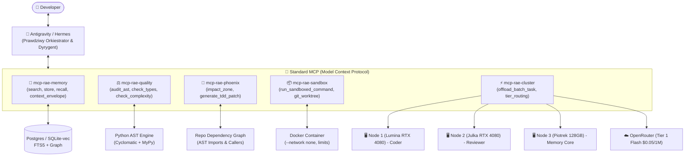

# 🚀 ITERACYJNY PLAN ROZWOJU RAE-SUITE (V3.0)
## Prywatna Hybrydowa Szyna Inżynieryjna: Antigravity / Hermes jako Orkiestrator + RAE jako Toolchain & Pamięć

**Status:** Plan wdrożeniowy (Approved Architecture)  
**Lokalizacja:** `/home/grzegorz/cloud/RAE-Suite/docs/ITERACYJNY_PLAN_ROZWOJU_RAE.md`  
**Data:** 10 października 2026  
**Nadrzędny Orkiestrator:** Antigravity (Google DeepMind) / Hermes Agent  
**Infrastruktura Obliczeniowa:** Klaster 3x NVIDIA RTX 4080 (48GB VRAM) + OpenRouter Tier 1–3  

---

## 1. STRATEGICZNY ZWROT ARCHITEKTONICZNY (THE PARADIGM SHIFT)

W toku krytycznego audytu kodu źródłowego oraz analizy dokumentów koncepcyjnych (`docs/specs/`, `docs/audit_reports/`, `docs/goal/`) zidentyfikowano pierwotną przyczynę problemów RAE-Suite: **próbę emulacji ludzkiego kierownictwa fabryki oprogramowania za pomocą sztywnego kodu w Pythonie (`autonomy_kernel.py`, 800 linii maszyn stanów, symulowane konsensusy, atrapy metryk).**

### Nowy Podział Ról (Zero Fikcji, Maksimum Skuteczności):
*   **Orkiestrator (Mózg i Decydent):** **Antigravity / Hermes**.
    Frontier models (Gemini / Claude / Nous Hermes) posiadają zdolności rozumowania, widzą edytor, terminal, diffy w czasie rzeczywistym i komunikują się bezpośrednio z człowiekiem. To one planują i decydują.
*   **RAE-Suite (Ciężkie Uzbrojenie i Pamięć Długoterminowa):**
    RAE przestaje udawać autonomicznego dyrektora. Staje się **Wyspecjalizowanym Narzędziem Inżynieryjnym (MCP Toolchain & Memory Backplane)**:
    1.  **`rae-core`**: Pamięć wielowarstwowa (working, episodic, semantic, reflective) z matematycznym decayem i bazą faktów projektowych.
    2.  **`rae-quality`**: Deterministyczny strażnik jakości (prawdziwe AST, złożoność cyklomatyczna, typowanie, SAST) działający w 20 ms.
    3.  **`rae-phoenix`**: Analizator strefy wpływu (`SystemIndexer`) i mechanik napraw TDD w oparciu o błędy z testów.
    4.  **`rae-sandbox`**: Efemeryczny `git worktree` + odcięty kontener Docker (`--network none`) do bezpiecznego odpalania ryzykownych poleceń.
    5.  **`Cluster & OpenRouter Burst`**: Tani i darmowy worker pool (Node 1, 2, 3 z RTX 4080 + OpenRouter Flash za $0.05/1M).

---

## 2. SYNTEZA NAJLEPSZYCH KONCEPCJI Z DOKUMENTACJI (`/docs`)

Nowy plan zachowuje i konsoliduje najcenniejsze zasoby intelektualne wypracowane w projekcie:

1.  **Hierarchia Autorytetu Wiedzy (`docs/goal/OKF-RAE-plan-rozwoju.md`)**:
    *   Wiedza to nie tylko "podobieństwo semantyczne wektorów". RAE rozróżnia źródła autorytetu: **Specyfikacja Kanoniczna > Reguła Biznesowa > Obserwacja z Testu > Hipoteza LLM**.
    *   Kryptograficzne łańcuchowanie audytowe (Hash Chaining SHA-256) dla decyzji krytycznych (ISO 27001 / ISO 42001).
2.  **Semantyczny Bezpiecznik Pętli (`docs/specs/HIVE-CIRCUIT-BREAKER.md`)**:
    *   Wykrywanie pętli ("Echo Loops"): jeśli odrzucenia audytora mają podobieństwo wektorowe $> 0.90$ lub zadanie odbija się 3 razy, następuje odcięcie (`BLOCKED_LOOP`) i eskalacja do wyższego modelu.
    *   Heartbeat zapobiegający zawieszeniu lokalnych modeli (`Anti-Hang`).
3.  **Kultura Evidence & ContextEnvelope (`docs/PLAN_POPRAWY_RAE_SUITE.md`, `docs/rozwoj-rae-01.md`)**:
    *   Koniec z surowymi wycinkami tekstu bez kontekstu. Każda informacja trafiająca do pamięci otrzymuje `ContextEnvelope` (plik, funkcja, linia, commit, autor).
    *   Generowanie `EvidencePackage` z sumą kontrolną SHA-256.
4.  **Konsensus Sterowany przez Antigravity (`docs/specs/RAE-Consensus-Flows.md`)**:
    *   Antigravity pisze/projektuje kod $\rightarrow$ szybki model recenzuje $\rightarrow$ deterministyczny linter AST sprawdza $\rightarrow$ zapis do gita w bezpiecznym sandboxie.

---

## 3. ARCHITEKTURA DOCELOWA: INTEGRACJA MCP

---

## 4. CZTEROETAPOWY ITERACYJNY PLAN ROZWOJU

Każda iteracja jest w 100% zorientowana na działający kod, posiada jasne kryteria akceptacji (Definition of Done) i eliminuje atrapy.

---

### 🟢 ITERACJA 0: HIGIENA, USUNIĘCIE FIKCJI I NAPRAWA KONTRAKTÓW DTO
**Cel:** Wyczyszczenie repozytorium z martwego kodu, usunięcie fałszywych symulacji i naprawa pękniętych interfejsów uniemożliwiających działanie w pętli.

#### Zadania do wykonania:
1.  **Naprawa kontraktu `rae-phoenix` $\leftrightarrow$ `rae-quality`**:
    *   W [`packages/rae-quality/models/report.py`](file:///home/grzegorz/cloud/RAE-Suite/packages/rae-quality/models/report.py) dodać pole `seniority_level: str = "Junior"` do `AuditResult`.
    *   W [`packages/rae-quality/main.py`](file:///home/grzegorz/cloud/RAE-Suite/packages/rae-quality/main.py) ustawiać `result.seniority_level = level.lower().replace(" ", "_")` (zwracając ujednolicony format, np. `advanced_senior`).
    *   W [`packages/rae-phoenix/main.py` linia 118](file:///home/grzegorz/cloud/RAE-Suite/packages/rae-phoenix/main.py#L118) odczytywać `verdict.get("seniority_level") == "advanced_senior"`.
    *   Zaktualizować test [`packages/rae-phoenix/tests/test_phoenix_closed_loop.py`](file:///home/grzegorz/cloud/RAE-Suite/packages/rae-phoenix/tests/test_phoenix_closed_loop.py) pod prawdziwy kontrakt.
2.  **Usunięcie atrap i symulacji**:
    *   Usunąć plik `core/phoenix_engine.py` (zawierający fałszywy `success = (attempt == 3)` i komentarz `# Phoenix Patch`).
    *   Usunąć `packages/rae-open-claw` (obcy projekt WhatsApp CLI generujący dług technologiczny).
3.  **Naprawa błędów składniowych i importów**:
    *   Poprawić błąd w `packages/rae-hive/agents/auditor/main.py` linia 27 (`file_path = fos.environ...` $\rightarrow$ `os.environ`).
    *   Naprawić `conftest.py` w `packages/rae-hive/tests/` (dodanie ścieżki do `base_agent` do `sys.path`).

**Kryteria Akceptacji (DoD):**
*   Testy `packages/rae-phoenix` i `packages/rae-quality` przechodzą na ujednoliconym kontrakcie DTO.
*   W kodzie nie ma ani jednej symulacji generującej fałszywe tokeny lub sukces po sztywnej liczbie prób.

---

### 🟢 ITERACJA 1: DETERMINISTYCZNY QUALITY GATE W `rae-quality` (REAL AST)
**Cel:** Zamiana mockowanych wartości (`coverage=0.85`, `complexity=8.0`, `type_safety=0.90`) na rzeczywisty, błyskawiczny analizator składniowy w Pythonie.

#### Zadania do wykonania:
1.  **Prawdziwa Analiza Złożoności i Typów w AST**:
    *   Stworzyć lekki, deterministyczny silnik w `packages/rae-quality/src/ast_inspector.py`:
        *   Obliczanie złożoności cyklomatycznej McCabe'a wprost z węzłów AST (`If`, `For`, `While`, `ExceptHandler`, `With`, `BoolOp`).
        *   Obliczanie Type Safety Ratio: $\frac{\text{funkcje i argumenty z adnotacjami typów}}{\text{wszystkie parametry i funkcje}}$ (bez `Any`).
        *   Wykrywanie pustych bloków, `pass` w obsłudze wyjątków oraz zakazanych słów kluczowych.
2.  **Podpięcie pod `SeniorityRanker`**:
    *   W `packages/rae-quality/main.py` podmienić atrapy `getattr(..., 0.85)` na wyniki z `ast_inspector.py`.
    *   Czas wykonania analizy dla pliku 500 linii: $< 25\text{ ms}$ (bez użycia LLM).
3.  **Wpięcie `TestIntegrityGuard`**:
    *   Weryfikacja, czy model nie zmodyfikował testów jednostkowych poprzez usunięcie słów kluczowych `assert` lub dekoratorów `@pytest.mark`.

**Kryteria Akceptacji (DoD):**
*   Plik z kodem bez typów i ze złożonością $> 15$ otrzymuje ocenę `Junior Developer` lub `Mid` i zostaje odrzucony przez Quality Gate.
*   Czysty, otypowany kod z docstringami otrzymuje `Senior` / `Advanced Senior` na podstawie realnych pomiarów.

---

### 🟢 ITERACJA 2: PHOENIX JAKO MECHANIK TDD DLA ORKIESTRATORA
**Cel:** Przekształcenie Phoenixa ze "ślepego generatora" w precyzyjne narzędzie naprawcze dla Antigravity / Hermes.

#### Zadania do wykonania:
1.  **Logika Naprawy Napędzana Błędem Testu (Test-Driven Repair)**:
    *   W `packages/rae-phoenix/main.py` zmodyfikować `process_repair_request`:
        *   Wejście: `target_file`, `test_failure_output` (stack trace z pytesta), `impact_zone`.
        *   Model generuje wyłącznie mikro-patch w formacie unified diff lub zaktualizowaną funkcję.
        *   Phoenix aplikuje patch w `GitWorktreeManager`.
        *   Uruchamia `pytest` w sandboxie. Jeśli testy zielone $\rightarrow$ zatwierdza. Jeśli czerwone po 3 próbach $\rightarrow$ `git reset` (rollback).
2.  **API Strefy Wpływu (`SystemIndexer`)**:
    *   Wystawienie metody `get_impact_zone(file_path)` zwracającej listę modułów, które importują zmieniany plik, aby Antigravity wiedział, jakie testy regresji należy uruchomić.

**Kryteria Akceptacji (DoD):**
*   Phoenix potrafi wziąć failujący test jednostkowy, zidentyfikować błąd, poprawić 3 linijki kodu w worktree, uruchomić test ponownie i zwrócić sukces bez niszczenia reszty pliku.

---

### 🟢 ITERACJA 3: ZUNIFIKOWANY SERWER MCP DLA ANTYGRAVITY I HERMESA
**Cel:** Bezpośrednia integracja RAE-Suite z narzędziami agentowymi programisty przez standard Model Context Protocol.

#### Zadania do wykonania:
1.  **Utworzenie serwera `packages/rae-mcp-server`**:
    *   Jeden lekki proces w FastAPI / mcp-python udostępniający komplet narzędzi:
        *   `rae_memory_search(query: str, layer: str = "all", k: int = 5)`: Wyszukiwanie hybrydowe z matematycznym decayem.
        *   `rae_memory_store(content: str, layer: str, metadata: dict, envelope: dict)`: Zapis wiedzy z atrybucją `ContextEnvelope`.
        *   `rae_quality_audit(code: str, file_path: str)`: Szybka ocena jakości AST i Seniority.
        *   `rae_phoenix_impact(file_path: str)`: Analiza grafu zależności dla danego pliku.
        *   `rae_sandbox_run(command: str)`: Bezpieczne uruchomienie polecenia w odizolowanym kontenerze Docker na `git worktree`.
        *   `rae_cluster_dispatch(prompt: str, tier: str = "tier1_flash")`: Zlecenie zadania do lokalnego klastra lub OpenRoutera.
2.  **Konfiguracja Antigravity**:
    *   Dodanie wpisu do `.gemini/settings.json` lub konfiguracji MCP agenta, rejestrującego serwer RAE.

**Kryteria Akceptacji (DoD):**
*   Antigravity może w dowolnym momencie sesji wywołać `rae_quality_audit` lub `rae_memory_search` bez konieczności uruchamiania zewnętrznych skryptów w terminalu.

---

### 🟢 ITERACJA 4: KLASTER 3x RTX 4080 + OPENROUTER JAKO ASYMETRYCZNY WORKER POOL
**Cel:** Optymalizacja kosztowa i wydajnościowa — delegowanie ciężkich i powtarzalnych zadań poza główny model Orkiestratora.

#### Zadania do wykonania:
1.  **Fizyczna Siatka Ról w Klastrze**:
    *   **Node 1 (Lumina RTX 4080)**: Dedykowany pod generowanie kodu w tle (np. `Qwen 2.5 Coder 14B`).
    *   **Node 2 (Julka RTX 4080 SUPER)**: Dedykowany pod audyt i reasoning w tle (np. `DeepSeek-R1 14B`).
    *   **Node 3 (Piotrek 128GB RAM)**: Baza Postgres, Qdrant, wektory i serwer API pamięci RAE.
2.  **Integracja z OpenRouter (Burst Computing)**:
    *   Zgodnie z `config/layer_triads_registry.yaml`:
        *   *Stopień I ($0.05/1M)*: Masowe generowanie testów, boilerplate, konwersje formatów.
        *   *Stopień II ($0.66/1M)*: Głębokie review architektury i analiza współbieżności.
        *   *Stopień III ($2.00/1M)*: Trudne spory i decyzje kanoniczne.
3.  **Wdrożenie Semantycznego Bezpiecznika (`SemanticWatchdog`)**:
    *   Ochrona budżetu: jeśli zadania delegowane do klastra lub OpenRoutera wykazują podobieństwo wektorowe błędów $> 0.90$, proces jest natychmiast ucinany.

**Kryteria Akceptacji (DoD):**
*   Możliwość zlecenia z Antigravity wygenerowania 10 testów na Node 1 ($0.00) lub przez OpenRouter Flash ($0.001) bez blokowania bieżącej sesji kodowania.

---

### 🟢 ITERACJA 5: KNOWLEDGE GOVERNANCE I DOWODY DECYZJI (ISO 27001 / ISO 42001)
**Cel:** Pełna realizacja założeń z `OKF-RAE-plan-rozwoju.md` — RAE jako niezaprzeczalna czarna skrzynka wiedzy i decyzji.

#### Zadania do wykonania:
1.  **Struktura `EvidencePackage` i `ContextEnvelope`**:
    *   Zapisywanie w warstwie `reflective` podsumowań zmian wraz z atrybucją: cel biznesowy, autor, zmodyfikowane pliki, wynik testów, model wykonujący, suma SHA-256.
2.  **Klasy Autorytetu Wiedzy**:
    *   Oznaczanie faktów w bazie pamięci tagami autorytetu: `authority:canonical` (specyfikacja), `authority:empirical` (wynik testu/log), `authority:heuristic` (podpowiedź LLM).
    *   Podczas wyszukiwania wiedza kanoniczna ma bezwzględne pierwszeństwo nad heurystykami.

**Kryteria Akceptacji (DoD):**
*   Każde wdrożenie nowego modułu generuje w pamięci RAE audytowalny, podpisany cyfrowo rekord decyzji zgodny ze standardem ISO 42001.

---

## 5. TABELA PODSUMOWUJĄCA TRANSFORMACJĘ

| Komponent | Stary Stan (Symulacje i Zacięcia) | Nowy Stan (V3.0 Toolchain dla Antigravity) |
| :--- | :--- | :--- |
| **Orkiestracja** | `autonomy_kernel.py` (800 linii maszyn stanów, pętle) | **Antigravity / Hermes** (Frontier Agent w edytorze) |
| **Pętla Phoenix** | Atrapa w `core/` (`success = attempt == 3`), broken contract | **TDD Repair Engine** na prawdziwych diffach i błędach pytest |
| **Audyt Quality** | Hardcode `0.85, 8.0, 0.90`, udawany konsensus 3 modeli | **Deterministyczny Linter AST** (złożoność, typy) w 20 ms |
| **Swarm / Hive** | `while True: sleep(20)` z nadpisywaniem plików `f.write()` | **Wycofany jako programista**, zachowany jako **Git Sandbox** |
| **Infrastruktura** | Nieskoordynowane skrypty, kolejkowanie na 1 maszynie | **3x RTX 4080 Mesh + OpenRouter Flash Tiering** |
| **Interfejs** | Osobne porty, niespójne endpointy HTTP | **Zunifikowany serwer MCP** wbudowany w Antigravity |

---

## 6. PIERWSZY KROK WYKONAWCZY (ACTION ITEM)

Rozpoczęcie od **Iteracji 0 i Iteracji 1**:
1. Naprawa modelu `AuditResult` w `packages/rae-quality` i dostosowanie warunku w `packages/rae-phoenix`.
2. Usunięcie `core/phoenix_engine.py` oraz `packages/rae-open-claw`.
3. Zaimplementowanie prawdziwego obliczania złożoności i typowania w AST w `packages/rae-quality`.

Plan został zapisany w repozytorium jako obowiązujący drogowskaz inżynieryjny dla dalszego rozwoju RAE.
