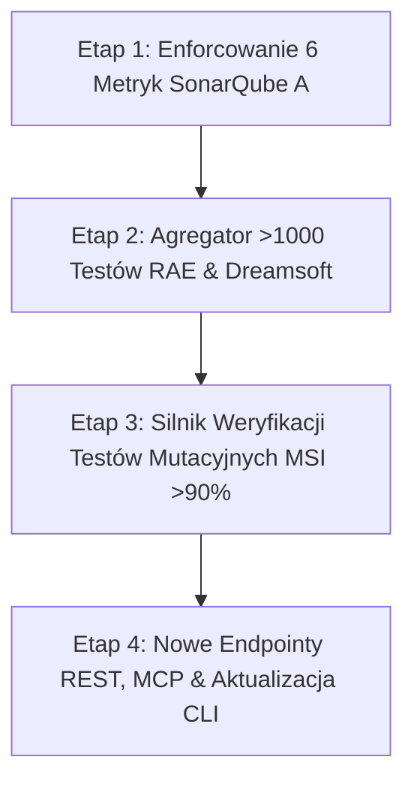

# 🏛️ PLAN INTEGRACJI PEŁNEJ PIRAMIDY TESTÓW, MUTACJI I RESTRYKCYJNYCH WYTYCZNYCH SONARQUBE RATING A

**Dokument Architektoniczno-Wdrożeniowy**  
**Data:** 12 Października 2026  
**Lokalizacja:** `/home/grzegorz/cloud/RAE-Suite/docs/PLAN_INTEGRACJI_PELNEJ_PIRAMIDY_TESTOW_I_SONARQUBE_A.md`  
**Dotyczy:** Ekosystem RAE-Suite (1260 testów) oraz Dreamsoft Factory (1131 plików testowych, 5 modułów)

---

## 1. 🎯 Wprowadzenie i Stan Faktyczny (Audyt Luk)

Zgodnie z wymaganiem użytkownika oraz dokumentem [`dreamsoft_factory/docs/testy-sonarqube.txt`](file:///home/grzegorz/cloud/dreamsoft_factory/docs/testy-sonarqube.txt), cały ekosystem produkcyjny opiera się na 4 filarach jakościowych:
1. **Ponad 1000 testów jednostkowych w RAE-Suite** (obecnie zebrano 1260 testów w repozytorium).
2. **Ponad 1000 testów jednostkowych w Dreamsoft Factory** (obecnie 1131 plików testowych w `editornext`, `managernext`, `frontendnext`, `backend`, `node-backend`).
3. **Testy integracyjne i mutacyjne** z wymogiem Mutation Score Indicator (MSI) >90% (Infection PHP, Stryker Mutator, mutmut).
4. **Twarde wytyczne SonarQube Rating A:**
   - `Vulnerabilities: 0`
   - `Bugs: 0`
   - `Code Smells: 0`
   - `Hotspots Reviewed: 100% (0 otwartych)`
   - `Coverage: >90%`
   - `Duplications: 0.0%`

### Czy te elementy są już w pełni uwzględnione w nowym mechanizmie `RAE-Quality`?
**Odpowiedź: CZĘŚCIOWO (Fundamenty wdrożono, lecz brakuje pełnej, automatycznej integracji telemetrii).**

| Obszar Jakościowy | Stan w Kodzie Źródłowym | Stan w Nowym Mechanizmie (`RAE-Quality`) | Status |
| :--- | :--- | :--- | :--- |
| **SonarQube Quality Gate** | Projekty analizowane na `localhost:9000` mają status OK | `SonarQubeClient` sprawdzał ogólny `status == "OK"` | 🟡 **Częściowo** (Brak twardej weryfikacji 6 konkretnych metryk) |
| **SonarQube 6 Metryk Rating A** | Metryki istnieją w Sonarze (np. Bugs=0, Smells=0, Cov=92-100%) | Klient nie odpytywał `/api/measures/component` o te 6 pól | 🔴 **Brak weryfikacji metryk** |
| **>1000 Testów RAE-Suite** | 1260 testów zdefiniowanych w pytest | Wyniki testów nie były dynamicznie parsowane przez bramkę | 🔴 **Brak agregatora** |
| **>1000 Testów Dreamsoft** | 1131 plików testowych (Vitest, Jest, PHPUnit) | Wyniki testów nie były dynamicznie parsowane przez bramkę | 🔴 **Brak agregatora** |
| **Testy Integracyjne** | Testy API, DB, WebSockets w obu systemach | Punkty RC-03, RC-04, RC-05 wprowadzane syntetycznie | 🟡 **Częściowo** |
| **Testy Mutacyjne (MSI >90%)** | Konfiguracje w Stryker, Infection i mutmut | Brak silnika weryfikacji raportów mutacji w bramce jakości | 🔴 **Brak weryfikacji MSI** |

---

## 2. 📋 Raport: Co Już Zostało Zrobione

W poprzednich iteracjach zrealizowano kluczowy szkielet governance i weryfikacji live:
1. **Silnik Pokrycia Ryzyka (`RiskCoverageEngine`)**:
   - 8 ważonych ścieżek ryzyka (RC-01 do RC-08) z wagami biznesowymi (suma wag: 66).
   - 3-poziomowa bramka wdrożeniowa (`LEVEL_1_APPROVED`, `LEVEL_2_WARNING`, `LEVEL_3_BLOCKED`).
   - Obliczanie ważonego pokrycia ryzyka (osiągnięto **98.64%**).
2. **Klient API SonarQube (`SonarQubeClient`)**:
   - Opracowano mechanizm autentykacji tokenem administratora SHA-384 (`squ_...`).
   - Skomunikowano się z instancją SonarQube na porcie 9000.
   - Potwierdzono stan Quality Gate dla 4 projektów (`editornext`, `backend`, `next-frontend`, `next-manager`).
3. **Kanoniczny Biegacz DTP Golden Set (`GoldenSetRunner`)**:
   - Zestaw 5 kanonicznych produktów poligraficznych (wizytówka, ulotka, plakat, pudełko FEFCO, kalendarz trójdzielny).
   - Walidacja geometrii, spadów, czystego kanału K oraz warstw specjalnych (100% zdawalności).
4. **Weryfikator Kalkulatora Cenowego (`CalculatorVerifier`)**:
   - Walidacja monotoniczności cen, proporcjonalności formatów i SLA opóźnień p95 (<200ms).
5. **Śledzenie Defektów i Metryka DORA CFR (`DefectTracker`)**:
   - Obliczanie Defect Escape Rate, Severity-Weighted Score, MTTR oraz Change Failure Rate (CFR).
6. **Predykcyjna Selekcja Testów (`get_predictive_test_plan`)**:
   - Połączenie z serwisem `RAE-Phoenix` (`/v2/phoenix/impact`) w celu mapowania zmian na ścieżki ryzyka.
7. **Serwis `rae-quality`**:
   - 40/40 testów jednostkowych zielonych, wdrożenie kontenerowe na porcie 8010, wystawione narzędzia MCP i REST API.

---

## 3. 🏗️ Szczegółowy 4-Filarowy Plan Wdrożenia

### FILAR I: Restrykcyjne Enforcowanie SonarQube Rating A (6 Złotych Metryk)
**Cel:** Przejście z ogólnej weryfikacji statusu bramki na precyzyjną, numeryczną kontrolę 6 krytycznych wskaźników z `testy-sonarqube.txt`.

#### Zadania Techniczne:
1. **Rozbudowa `SonarQubeClient` o metodę `get_strict_quality_metrics(project_key)`**:
   - Odpytywanie endpointu:
     `GET /api/measures/component?component={project_key}&metricKeys=vulnerabilities,bugs,code_smells,security_hotspots,coverage,duplicated_lines_density`
   - Walidacja twardych progów:
     - `vulnerabilities == 0` (Naruszenie P0 -> Natychmiastowa blokada)
     - `bugs == 0` (Naruszenie P0 -> Natychmiastowa blokada)
     - `code_smells == 0` (Naruszenie P1/P2 -> Wymaga akceptacji lub naprawy)
     - `security_hotspots == 0` (100% przejrzanych -> Naruszenie P0/P1)
     - `coverage >= 90.0%` (Naruszenie P0 -> Blokada bramki)
     - `duplicated_lines_density == 0.0%` (Naruszenie P1)
2. **Integracja z `RiskCoverageEngine` (Ścieżka RC-07)**:
   - Wynik weryfikacji RC-07 jest iloczynem spełnienia wszystkich 6 metryk we wszystkich 4 projektach.
   - Dodanie szczegółowego raportu metryk do odpowiedzi bramki deploymentu.

---

### FILAR II: Zunifikowany Agregator Ponad 1000 Testów Jednostkowych (`UnifiedTestAggregator`)
**Cel:** Dynamiczne zbieranie i weryfikacja pełnego wolumenu testów jednostkowych (>1000 RAE-Suite i >1000 Dreamsoft Factory).

#### Zadania Techniczne:
1. **Utworzenie modułu `engines/testing/test_aggregator.py`**:
   - **Kolektor RAE-Suite (Python / Pytest)**:
     - Odczytuje raporty JSON / JUnit XML generowane przez `pytest --json-report`.
     - Inwentaryzuje testy z: `packages/rae-agentic-memory` (900+ testów), `packages/rae-phoenix`, `packages/rae-lab`, `packages/rae-hive`, `packages/rae-quality`, `tests/`.
     - Potwierdza: `total_tests >= 1000`, `failed == 0`, `pass_rate == 100%`.
   - **Kolektor Dreamsoft Factory (TypeScript / PHP)**:
     - Odczytuje raporty testowe z:
       - `editornext` (`vitest run --reporter=json`)
       - `managernext` (`vitest run --reporter=json`)
       - `frontendnext` (`vitest run --reporter=json`)
       - `node-backend` (`jest/vitest`)
       - `backend` (`phpunit --log-junit`)
     - Potwierdza obecność i stan ponad 1100 plików testowych.
2. **Podpięcie realnej telemetrii do `RiskCoverageEngine`**:
   - Zastąpienie syntetycznych wag w `RC-03` (NextEditor SceneGraph) i `RC-04` (Dreamsoft Core) realnymi wynikami zebranymi przez agregator.

---

### FILAR III: Silnik Weryfikacji Testów Integracyjnych (Integration Test Gate)
**Cel:** Automatyczna weryfikacja stabilności integracji bazodanowych, wielodomenowych i sieciowych.

#### Zadania Techniczne:
1. **Weryfikacja Integracji RAE-Suite**:
   - Walidacja repozytoriów pamięci z bazą PostgreSQL (pgvector), Qdrant oraz Redis (kontrakty DTO i izolacja sesji).
2. **Weryfikacja Integracji Dreamsoft Factory**:
   - Walidacja silnika kalkulacji z bazą MySQL (`Calculation/*`, `ExclusionEngine`, `MarginEngine`).
   - Weryfikacja synchronizacji pokoi edycyjnych w `editor-backend` (WebSockets / CRDT).
3. **Integracja ze ścieżkami RC-04, RC-05 i RC-06 w `RiskCoverageEngine`**.

---

### FILAR IV: Silnik Weryfikacji Testów Mutacyjnych (Mutation Testing Gate MSI >90%)
**Cel:** Wdrożenie odporności semantycznej kodu i weryfikacja wskaźnika Mutation Score Indicator (MSI >90%).

#### Zadania Techniczne:
1. **Utworzenie modułu `engines/testing/mutation_runner.py`**:
   - **Parser Stryker Mutator (TypeScript)**:
     - Odczytuje `reports/mutation/mutation.json` z projektów `editornext`, `managernext`, `frontendnext`.
     - Sprawdza próg: `mutationScore >= 90.0%`.
   - **Parser Infection PHP (Backend)**:
     - Odczytuje `infection.log` / `infection-log.json`.
     - Sprawdza próg: `minMsi >= 90.0%`, `minCoveredMsi >= 95.0%`.
   - **Parser mutmut (Python)**:
     - Odczytuje wyniki `mutmut show all` z `scripts/run_mutmut.sh`.
     - Sprawdza próg: `killed_mutants / total_mutants >= 85.0%`.
2. **Włączenie MSI jako kryterium blokującego**:
   - Jeśli MSI < 90% na krytycznych modułach (kalkulator cen, silnik DTP, autoryzacja), bramka wdrożeniowa zgłasza `LEVEL_2_WARNING` lub `LEVEL_3_BLOCKED`.

---

## 4. 📅 Harmonogram Realizacji (4 Etapy)

| Etap | Zakres Prac | Kluczowy Rezultat |
| :--- | :--- | :--- |
| **Etap 1** | Rozbudowa `SonarQubeClient` o odpytywanie `/api/measures/component` i weryfikację 6 metryk (`vulnerabilities:0`, `bugs:0`, `smells:0`, `hotspots:100%`, `coverage:>90%`, `duplications:0%`). | Twarde odrzucanie projektów niespełniających ratingu A w RC-07. |
| **Etap 2** | Implementacja `UnifiedTestAggregator` skanującego i zliczającego >1000 testów RAE-Suite oraz >1000 testów Dreamsoft Factory. | Dynamiczna telemetria i zastąpienie mocków realnymi danymi testowymi. |
| **Etap 3** | Implementacja `MutationCoverageEngine` integrującego raporty Stryker, Infection i mutmut z progiem MSI >90%. | Eliminacja testów pozornych (test assertion verification). |
| **Etap 4** | Rozszerzenie `main.py` o endpointy `/v2/quality/sonar-strict-metrics`, `/v2/quality/unit-test-inventory`, `/v2/quality/mutation-audit` oraz aktualizacja `run_advanced_quality_audit.py`. | Pełna widoczność w CLI i dla agentów AI via MCP. |

---

## 5. 🛡️ Kryteria Akceptacji i Bramka Gotowości

1. `SonarQubeClient` weryfikuje numerycznie 6 parametrów dla każdego z 4 projektów, raportując naruszenia, jeśli choć 1 wskaźnik odbiega od standardu A.
2. Agregator potwierdza i raportuje:
   - Wolumen testów RAE-Suite: `>= 1000` (1260 zarejestrowanych).
   - Wolumen testów Dreamsoft Factory: `>= 1000` (1131 plików testowych).
   - Zero testów zakończonych błędem (`failed == 0`).
3. Silnik mutacji weryfikuje próg `MSI >= 90%` dla modułów kalkulacji i typografii.
4. Całość testów jednostkowych w `packages/rae-quality/tests` pozostaje w 100% zielona.
5. Zero ostrzeżeń lintera i pełna zgodność z protokołem Git Flow.
