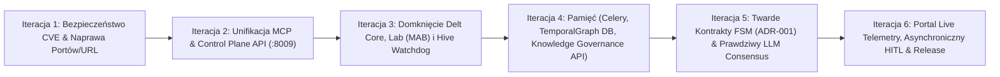

# 🚀 Kompleksowy Audyt Dokumentacji i Iteracyjny Plan Poprawy oraz Orkiestracji RAE-Suite (v3.8.4 -> v4.0)

**Data audytu:** 2026-10-18  
**Zakres:** Cały ekosystem `/home/grzegorz/cloud/RAE-Suite` (Core, MCP, Memory, Quality, Phoenix, Hive, Lab, OpenClaw, Portal) oraz pełna weryfikacja katalogu `/home/grzegorz/cloud/RAE-Suite/docs/*` względem kodu źródłowego.  
**Cel główny:** Zapewnienie w 100% płynnego, bezawaryjnego i deterministycznego działania oraz orkiestracji RAE-Suite przez agentów AI (Antigravity, Hermes, Claude, OpenClaw) lokalnie, na klastrze (Node 1 Lumina) oraz w chmurze (Kubernetes).

---

## 1. Diagnoza Płynności Orkiestracji przez Agenta AI (Stan Obecny)

Jako agent AI (Antigravity) orkiestrujący `RAE-Suite` mam do dyspozycji silny fundament: zunifikowany serwer MCP (`packages/rae-mcp-server/server.py`), bramkę `RAEQualityGatewayV2` zintegrowaną w `rae-suite` (`:8009`) i `rae-quality` (`:8010`), 3-warstwowy silnik konsensusu (`LayerTriadRunner`), pamięć wielowarstwową (`rae-memory` `:8000`) oraz piaskownice `GitWorktree + Docker`.

Podczas przeglądu kodu źródłowego pod kątem **płynności orkiestracji przez agenta** zidentyfikowano jednak **7 wąskich gardeł (friction points)**, które utrudniają pełną autonomię:

1. **Rozdwojenie serwerów MCP (`packages/rae-mcp-server/server.py` vs `rae_mcp_server.py`):**
   - Lokalny agent korzysta z `packages/rae-mcp-server/server.py` (stdio, 9 narzędzi: `rae_memory_search`, `rae_memory_store`, `rae_quality_audit`, `rae_phoenix_impact`, `rae_phoenix_repair`, `rae_sandbox_exec`, `rae_cluster_dispatch`, `rae_consolidate_traces`), natomiast kontener `rae-supervisor` (`:8005`) uruchamia starszy plik `rae_mcp_server.py` (SSE, tylko 5 narzędzi diagnostycznych, brak narzędzi `RAE-Quality 2.0`, `Phoenix`, `Cluster Dispatch` czy `AutonomyKernel` task dispatch).
2. **Niezgodności domyślnych portów i URL-i między modułami (Port Drift):**
   - W `packages/rae-phoenix/main.py` (linia 33) domyślny `QUALITY_API_URL` to `http://localhost:8011` (podczas gdy port `8011` należy do `rae-lab`, a `rae-quality` działa na `8010` lokalnie / `http://rae-quality:8000` w sieci Docker!). W `docker-compose.yml` kontener `rae-phoenix` nie ma przekazanego `QUALITY_API_URL=http://rae-quality:8000`.
   - W `packages/rae-hive/strategies/semantic_watchdog.py` (linia 12) `RAE_API_URL` wskazuje na `http://localhost:8001` zamiast `http://rae-memory:8000` / `http://localhost:8000`.
   - W `rae_suite_orchestrator.py` (linia 39) domyślny `RAE_API_URL` to `http://localhost:8011` zamiast `http://localhost:8000`.
3. **Brak bezpośredniego endpointu HTTP/MCP dla `AutonomyKernel.execute_task` i `RAE_CEO_Orchestrator` w `main.py` (`:8009`):**
   - Główny serwer `main.py` (`RAE-Suite Control Plane v2.0` na porcie `8009`) wystawia `/v2/factory/reconcile`, `/v2/fabric/route`, `/v2/audit/evaluate` oraz wszystkie nowe endpointy `/v2/quality/*`, ale **nie wystawia** endpointu `/v2/kernel/execute` ani `/v2/orchestrator/tick`, przez co agent nie może jednym wywołaniem REST/MCP zlecić pełnego cyklu życia zadania (`RECEIVED -> ... -> QUALITY_GATE -> COMPLETED`).
4. **Zamockowana obserwacja kontenerów i dryfu w `rae_suite_orchestrator.py`:**
   - W `rae_suite_orchestrator.py` (linia 158) lista uruchomionych kontenerów jest zahardkodowana (`"active_agents": ["rae-phoenix", "rae-hive", "rae-quality"] # Mock actual docker running states`), a `_align_drift` jedynie zapisuje zdarzenie do pamięci, zamiast realnie wywołać `InfraReconciler` / Docker API.
5. **Brak narzędzia MCP do pełnego skanowania `RAE-Quality 2.0` (8 operacji RPC):**
   - Narzędzie MCP `rae_quality_audit` w `packages/rae-mcp-server/server.py` uruchamia tylko szybki lokalny `ASTInspector` + `SeniorityRanker` na pojedynczym wycinku kodu (`snippet.py`), zamiast udostępniać agentowi pełny dispatcher `quality.*` (`quality.analyze_diff`, `quality.security_scan`, `quality.verify_fix`, `quality.check_architecture`, `quality.release_gate`) wdrożony w `RAEQualityGatewayV2`.
6. **Brak uruchomionego procesu `rae_suite_orchestrator.py` oraz `celery-worker`/`celery-beat` w `docker-compose.yml` i K8s:**
   - Pętla CEO (`rae_suite_orchestrator.py`), `SemanticWatchdog` (`semantic_watchdog.py`) oraz zadania tła pamięci (`decay_importance`, konsolidacja, outbox governance) nie mają zdefiniowanych procesów uruchomieniowych w `docker-compose.yml` ani `04-apps.yaml`.
7. **Martwe komponenty w głównej ścieżce wykonania:**
   - `SpeculativeToolExecutor` (`core/speculative_executor.py`) oraz `MABTuner` (`packages/rae-lab/metrics_aggregator.py`) posiadają pełną logikę i testy jednostkowe, ale nie są podłączone do `AutonomyKernel.execute_task` ani `CostAwareRouter.route`.

---

## 2. Audyt Wdrożenia Dokumentacji (`/home/grzegorz/cloud/RAE-Suite/docs` vs Kod)

Poniższa tabela przedstawia dokładny wynik weryfikacji każdego katalogu i dokumentu w `/home/grzegorz/cloud/RAE-Suite/docs` względem rzeczywistego stanu kodu źródłowego:

| Katalog / Dokument w `docs/` | Co opisuje specyfikacja | Co jest wdrożone w kodzie | Czego brakuje / Rozbieżności | Status Wdrożenia |
| :--- | :--- | :--- | :--- | :--- |
| **`docs/poziom-bezpieczeństwa-kodu.md`** oraz **`docs/PLAN_POPRAWY_PERFEKCJI_RAE_QUALITY_V2.md`** | 9-warstwowa architektura `RAE-Quality 2.0`, 6 klas ryzyka (`R0–R5`), 8 operacji RPC (`quality.*`), `SecurityScannerEngine`, `ArchitectureGuardEngine`, `TestPyramidsEngine` (`pytest`, `hypothesis`, `mutmut`), `PatchVerifierEngine`, `PromotionGateEngine`, `RollbackWatchEngine`, `ReportSchemaValidator`, SQLite persistence. | W pełni zaimplementowane w `packages/rae-quality/engines/governance/` i `engines/testing/`, podpięte pod `rae-quality` (`:8010`), `rae-suite` (`:8009`), zbudowane w Harbor (`2.9.2`), wdrożone w K8s i na Node 1. Pokryte 72 testami E2E/unit. | Brak rozbieżności w samym silniku. Możliwe rozszerzenie o ekspozycję wszystkich 8 operacji RPC bezpośrednio w `packages/rae-mcp-server/server.py`. | **100% WDROŻONE** |
| **`docs/adr/ADR-001-RAE-Suite-Contracts-FSM.md`** | Kanoniczne kontrakty Pydantic v2 (`extra="forbid"`, `strict=True`, `UtcDateTime`, `Sha256Hex`), maszyna stanów `TaskState`, `TERMINAL_TASK_STATES`, zabezpieczenia `V-01..V-09` (JWT RS256 binding, izolacja `tenant_id`, `TransitionContract`, tabela `transition_attempts` w osobnej transakcji, triggery PostgreSQL `block_terminal_update()`, uniwersalny `Idempotency-Key` z JCS). | W `rae_contracts/autonomy.py` i `core/autonomy_kernel.py` wdrożono `CONTRACT_CONFIG`, wszystkie modele DTO i Response (z redakcją pól wrażliwych), `TERMINAL_TASK_STATES`, walidację JWT RS256 (`V-01`) oraz blokadę `tenant_id` (`V-02`). | Brakuje: 1) jawnego egzekutora `TransitionContract` (`Authorize -> Guard -> Apply`) z hierarchią błędów `TransitionError`, 2) zapisu nieudanych przejść `transition_attempts` i wyzwalaczy PostgreSQL `block_terminal_update()` (`V-04`, `V-08`), 3) uniwersalnego `Idempotency-Key` (RFC 8785 JCS) i licznika `cycleCount <= cycleLimit` (`V-03`, `V-06`, `V-07`). | **~65% WDROŻONE** |
| **`docs/audit_reports/*`** (`OVERVIEW.md`, `INTERACTIONS.md`, `SPEC_VS_REALITY.md`, `MODULE_CORE.md` .. `MODULE_OPENCLAW.md`) | Raport z audytu 7 modułów RAE-Suite identyfikujący 6 krytycznych rozbieżności (Delt 1–6) między specyfikacją a kodem. | **Delta 6 (`TestIntegrityGuard` w `QualityTribunal`)** została przez nas w 100% naprawiona i wdrożona w `v3.8.1`. Pozostałe analizy z plików `MODULE_*.md` idealnie pokrywają się ze stanem kodu. | **Delty 1–5** z raportu nadal wymagają zamknięcia w kodzie (Celery w Dockerze, persistencja `TemporalGraphService`, integracja `MABTuner` z `CostAwareRouter`, dynamiczne gałęzie LLM w `CognitivePlanner`, asynchroniczny HITL w `OpenClaw`). | **Audyt aktualny (1/6 delt zamknięta, 5 do wdrożenia)** |
| **`docs/goal/OKF-RAE-plan-rozwoju.md`** oraz **`docs/goal/detailed_implementation_plan.md`** | **RAE Knowledge Governance Layer**: typowanie nominalne (`BrandedStr`), inwentarz `config/knowledge-source-inventory.yaml`, tabele PostgreSQL (`rae_knowledge_registry`, `rae_knowledge_revisions`, `rae_knowledge_revision_payloads`, `rae_knowledge_supersedes`, `rae_governance_audit_events`, `rae_governance_outbox`), `DefaultKnowledgeResolutionEngine`, `AdapterBroker`, `SecureCacheEngine` (L1/L2 + MessagePack + Lua lock), kanoniczny łańcuch skrótów (`calculate_audit_hash`). | Zaimplementowano w `packages/rae-agentic-memory/`: istnieje `config/knowledge-source-inventory.yaml`, migracja Alembic `20260720_knowledge_registry.py`, modele w `rae_core/models/knowledge.py` i `evidence.py`, oraz pełny pakiet `rae_core/governance/` (`engine.py`, `adapter_broker.py`, `secure_cache.py`, `cache_serialization.py`, `hashing.py`). | Warstwa `rae_core/governance/` nie jest jeszcze wyeksponowana jako endpoint REST `/v2/knowledge/resolve` w `apps/memory_api` ani jako narzędzie MCP, brakuje konkretnych adapterów I/O (OpenAPI, Git, SonarQube) podpiętych pod `AdapterBroker` w runtime oraz workera publikującego `rae_governance_outbox`. | **~75% WDROŻONE (Rdzeń i DB gotowe, brak ekspozycji API/MCP)** |
| **`docs/goal/vulnerabilities_remediation_plan.md`** | Plan aktualizacji 5 bibliotek podatnych na CVE w `requirements-locked.txt`: `PyJWT>=2.13.0`, `pydantic-settings>=2.14.2`, `nltk>=3.10.1`, `ecdsa>=0.19.3`, `diskcache>=5.7.0`. | **Nie wdrożono.** W plikach `packages/{rae-hive,rae-lab,rae-phoenix,rae-quality}/requirements-locked.txt` nadal znajdują się stare wersje: `PyJWT==2.12.1`, `pydantic-settings==2.13.1`, `nltk==3.9.4`, `ecdsa==0.19.2`, `diskcache==5.6.3`. | Wymagana natychmiastowa aktualizacja wszystkich 4 plików `requirements-locked.txt` i przebudowa obrazów. | **0% WDROŻONE (PILNE!)** |
| **`docs/specs/HIVE-CIRCUIT-BREAKER.md`** | `SemanticWatchdog` wykrywający pętle semantyczne (`Echo Loops` przy `similarity > 0.90` lub 3 odrzuceniach) oraz zawieszenia (`Silent Hangs` przy braku Heartbeatu AST > 120s) z eskalacją do L3. | Istnieje skrypt `packages/rae-hive/strategies/semantic_watchdog.py` wykrywający $\ge 2$ odrzucenia i zapisujący refleksję `L3` oraz status `BLOCKED_L3`. | 1) Skrypt nie jest uruchamiany automatycznie w kontenerze `rae-hive` ani `rae-suite`, 2) ma zahardkodowany port `8001` zamiast `8000`, 3) brak obliczania podobieństwa wektorowego (`similarity > 0.90`), 4) brak 60s Heartbeatu AST i automatycznego `docker restart`. | **~55% WDROŻONE** |
| **`docs/specs/RAE-Consensus-Flows.md`** | Dwa przepływy konsensusu: 1) `RAE_PLANNING_FLOW=consensus_chain` (5 modeli LLM w `CognitivePlanner`), 2) `RAE_CODING_FLOW=review_loop` (Coder -> DeepSeek R1 -> Approver w `AutonomyKernel`). | W pełni zaimplementowane w `core/cognitive_planner.py` (`_plan_consensus_chain`) oraz `core/autonomy_kernel.py` (`_execute_review_loop_coding`) i przekazane w `docker-compose.yml`. | W środowisku bez skonfigurowanego `rae_core.llm.resolve_llm_runtime` przełącza się na bezpieczny `MockProvider` — warto podpiąć bezpośrednio pod `LayerTriadRunner` (`core/layer_triad_runner.py`), który ma gotową integrację z OpenRouter i Node 1! | **95% WDROŻONE** |
| **`docs/specs/RAE-SUITE-MANIFESTO-v1.md`**, **`RAE_FULL_CAPABILITIES_INVENTORY.md`**, **`RAE_FULL_CONFIG_MAP.md`** | Architektura 3 poziomów (L1 Working Swarm, L2 Expert Council, L3 Supreme Council), 6-etapowy lejek produkcyjny oraz pełna mapa możliwości i konfiguracji. | Zaimplementowane w `config/layer_triads_registry.yaml`, `core/layer_triad_runner.py`, `core/autonomy_kernel.py`, `rae-agentic-memory` i `rae-quality`. | Drobne rozbieżności w `RAE_FULL_CONFIG_MAP.md` (np. `max_attempts = 5` w `rae-phoenix/main.py` zamiast `3` opisanych w `RAE_FULL_CAPABILITIES_INVENTORY.md`). | **95% WDROŻONE** |
| **`docs/specs/RAE_UNIFIED_UI_UX_SPECIFICATION.md`** | Ujednolicony portal NiceGUI/Quasar (`rae-portal`), 14 widoków modułowych, WebSocket live-sync, Cache-Control headers, PWA Service Worker + IndexedDB (`localForage`). | W `packages/rae-agentic-memory/rae-portal/main.py` i `apps/*.py` wdrożono wszystkie 14 widoków (`MissionControl`, `SearchConsole`, `DecayRetention`, `EvolutionLab`, `PhoenixRepair`, `HiveSandbox`, `OpenClawEscalation`, `RaeCrl`, `MeshFederation`, `CentralAuditor`, `PDKnowledgeHub`) oraz WebSocket client. | 1) Klasa `PortalDashboardAggregator` w `core/portal_dashboards.py` zwraca statyczne wartości domyślne zamiast żywych danych z API, 2) brak pełnego Service Workera PWA i hydratacji IndexedDB (`localForage`) dla trybu RAE-Lite. | **~80% WDROŻONE** |
| **`docs/guides/PRZEWODNIK_DLA_KUBUSIA_KODOWANIE_I_TESTY.md`** | Przewodnik pracy z agentem Hermes, piramidą testów (`pytest`, `hypothesis`, `mutmut`), `SonarQube Rating A` i `RAE-CRL` na Node 1 (Lumina). | Wspierany przez infrastrukturę Node 1 (`100.68.166.117`) oraz wdrożony silnik `TestPyramidsEngine` w `rae-quality`. | W `AutonomyKernel` wywołanie `HERMES_API_URL` (`http://localhost:8022/v1/plan`) nie ma odpowiadającego mikroserwisu HTTP — warto zintegrować je z `LayerTriadRunner` (`local_gpu_triad` na Node 1). | **95% WDROŻONE** |
| **`docs/old/*`** (76 plików archiwalnych) | Historyczne plany rozwoju (`v3`–`v6.9`), raporty trybunału (`P0–P3`, `A2A`, `Portal`), logi `.jsonl` i `models-for-rae.md`. | Kluczowe mechanizmy zostały przeniesione do obecnego jądra i `docs/specs/` oraz `docs/goal/`. | Plik `docs/old/models-for-rae.md` jest nadal cytowany jako główna referencja w `GEMINI.md` — powinien zostać przeniesiony z `docs/old/` do `docs/specs/models-for-rae.md`. Plik `Linkedin_Posts_2024_Blue.pdf` jest zbędny. | **ARCHIWUM (Wymaga porządków)** |

---

## 3. Analiza Moduł po Module: Co TRZEBA poprawić (MUST) vs Co MOŻNA poprawić (SHOULD / COULD)

### Moduł 1: `RAE-Suite Core & Orchestrator` (`main.py`, `rae_suite_orchestrator.py`, `core/*`, `rae_contracts/*`)

#### 🔴 Co TRZEBA poprawić (MUST — krytyczne dla działania i orkiestracji):
1. **Wystawienie endpointów wykonawczych `AutonomyKernel` i `LayerTriadRunner` w `main.py` (`:8009`):**
   - Obecnie `main.py` nie pozwala agentowi ani innym serwisom wywołać `AutonomyKernel.execute_task` przez HTTP. Należy dodać endpointy `POST /v2/kernel/execute`, `POST /v2/triad/run` oraz `POST /v2/orchestrator/reconcile`.
2. **Naprawa domyślnego `RAE_API_URL` i odczytu stanu kontenerów w `rae_suite_orchestrator.py`:**
   - Zmienić domyślny `RAE_API_URL` z `http://localhost:8011` na `http://localhost:8000` (lub `http://rae-memory:8000` w Dockerze).
   - Zastąpić mock `"active_agents": ["rae-phoenix", "rae-hive", "rae-quality"]` (linia 158) rzeczywistym sprawdzeniem endpointów `/health` poszczególnych usług (`rae-phoenix`, `rae-hive`, `rae-quality`, `rae-lab`, `rae-memory`) oraz wywołaniem `InfraReconciler` w `_align_drift`.
3. **Podłączenie `CognitivePlanner` (`_plan_consensus_chain`) i `_execute_review_loop_coding` w `AutonomyKernel` pod `LayerTriadRunner`:**
   - Obecnie oba przepływy próbują importować nieistniejący `from rae_core.llm import resolve_llm_runtime` i wpadają w `MockProvider`. Podłączenie ich bezpośrednio do działającego `LayerTriadRunner` (`core/layer_triad_runner.py`) natychmiast uruchomi prawdziwe modele z OpenRouter / Node 1 (Lumina).
4. **Dokończenie wymagań bezpieczeństwa z `ADR-001` (`V-03`, `V-04`, `V-06`, `V-07`, `V-08`):**
   - Dodać klasę `TransitionContract` (`authorize`, `guard`, `apply`), licznik `cycle_count <= cycle_limit` (ochrona przed pętlami stanów) oraz walidację `Idempotency-Key` z kanonicznym hashem payloadu.

#### 🟡 Co MOŻNA poprawić (SHOULD / COULD — optymalizacje i rozwój):
1. **Aktywacja `SpeculativeToolExecutor` w `AutonomyKernel.execute_task`:**
   - W stanie `PLANNED` / `DRY_RUN` uruchamiać spekulatywnie bezpieczne komendy odczytu (`git status`, `git diff`, `pytest --collect-only`) przy użyciu gotowej klasy `core/speculative_executor.py`.
2. **Zastąpienie martwego wywołania `http://localhost:8022/v1/plan` (Hermes) wywołaniem `LayerTriadRunner` (`tier3_judge` lub `local_gpu_triad`):**
   - Gdy zadanie kończy się statusem `FAILED`, zamiast odpytywać nieistniejący port `8022`, wygenerować plan naprawczy przez triadę modeli.
3. **Usunięcie zahardkodowanych ścieżek `/home/grzegorz-lesniowski/...` w starych skryptach diagnostycznych (`scripts/validate_rae_integration.py` itp.):**
   - Zastąpić je dynamicznym `Path(__file__).resolve().parent.parent`.

---

### Moduł 2: `RAE-MCP & Supervisor` (`packages/rae-mcp-server/server.py`, `rae_mcp_server.py`, `supervisor_mcp.py`)

#### 🔴 Co TRZEBA poprawić (MUST):
1. **Unifikacja `rae_mcp_server.py` (kontener `rae-supervisor` `:8005`) z `packages/rae-mcp-server/server.py`:**
   - Agent łączący się przez stdio (`packages/rae-mcp-server/server.py`) i agent łączący się przez SSE (`:8005`) powinny widzieć ten sam, pełny zestaw narzędzi MCP.
2. **Dodanie narzędzi MCP dla pełnego `RAE-Quality 2.0` oraz `AutonomyKernel` w `packages/rae-mcp-server/server.py`:**
   - Rozszerzyć `rae_quality_audit` (lub dodać `rae_quality_rpc`), aby agent mógł wywołać dowolną z 8 operacji `RAE-Quality 2.0` (`quality.get_policy`, `quality.analyze_diff`, `quality.security_scan`, `quality.generate_tests`, `quality.verify_fix`, `quality.check_architecture`, `quality.release_gate`, `quality.report`).
   - Dodać narzędzie `rae_kernel_execute` pozwalające agentowi zlecić zadanie bezpośrednio do `AutonomyKernel` oraz `rae_knowledge_resolve` odpytujące `DefaultKnowledgeResolutionEngine`.

#### 🟡 Co MOŻNA poprawić (SHOULD / COULD):
1. **Refaktoryzacja legacy skryptu `supervisor_mcp.py`:**
   - Plik `supervisor_mcp.py` w głównym katalogu używa przestarzałych wywołań `urllib.request`, `shell=True` do `psql` i portu `8001`. Należy go zintegrować z `rae_suite_orchestrator.py` lub przenieść do archiwum.

---

### Moduł 3: `rae-agentic-memory` & `rae-core` (`packages/rae-agentic-memory`)

#### 🔴 Co TRZEBA poprawić (MUST):
1. **Dodanie kontenerów `rae-am-celery-worker` i `rae-am-celery-beat` do `docker-compose.yml` (oraz K8s `04-apps.yaml`) [Delta 1]:**
   - Uruchomić z tego samego obrazu co `rae-memory` (`One Image strategy`) procesy `celery -A apps.memory_api.celery_app worker` oraz `celery -A apps.memory_api.celery_app beat`, aby aktywować cykliczny rozpad ważności wspomnień (`decay_importance`), konsolidację refleksji i opróżnianie outboxa.
2. **Trwały zapis migawek w `TemporalGraphService` (`apps/memory_api/services/temporal_graph.py`) [Delta 2]:**
   - Obecnie `create_snapshot`, `get_snapshot_at_time` i `record_change` zapisują dane wyłącznie w słownikach RAM (`self._snapshots`, `self._changes`), które znikają po restarcie kontenera. Należy podpiąć je pod PostgreSQL (`graph_repo` / tabelę `knowledge_graph_snapshots`).
3. **Ekspozycja `RAE Knowledge Governance Layer` (`rae_core/governance/engine.py`) w REST API (`apps/memory_api`) [Domknięcie `docs/goal/OKF-RAE-plan-rozwoju.md`]:**
   - Dodać endpoint `POST /v2/knowledge/resolve` w `apps/memory_api`, który wykorzystuje gotowy `DefaultKnowledgeResolutionEngine`, `AdapterBroker`, `SecureCacheEngine` oraz tabele z migracji `20260720_knowledge_registry.py`.
   - Zastąpić bezwzględne ścieżki `/home/grzegorz/cloud/...` w `config/knowledge-source-inventory.yaml` zmiennymi środowiskowymi / ścieżkami względnymi kompatybilnymi z kontenerem Docker.

#### 🟡 Co MOŻNA poprawić (SHOULD / COULD):
1. **Worker publikujący zdarzenia z tabeli `rae_governance_outbox`:**
   - Dodać zadanie w Celery przetwarzające rekordy `pending` z `rae_governance_outbox` z obsługą `FOR UPDATE SKIP LOCKED`.
2. **Porządek w strukturze `rae_core/models.py` vs `rae_core/models/`:**
   - Zgodnie z notatkami długu technicznego ujednolicić modele do pakietu `rae_core/models/`.

---

### Moduł 4: `rae-quality` (`packages/rae-quality`)

#### 🔴 Co TRZEBA poprawić (MUST):
1. **Aktualizacja podatnych zależności w `packages/rae-quality/requirements-locked.txt`:**
   - Zaktualizować `PyJWT>=2.13.0`, `pydantic-settings>=2.14.2`, `nltk>=3.10.1`, `ecdsa>=0.19.3`, `diskcache>=5.7.0` zgodnie z `docs/goal/vulnerabilities_remediation_plan.md`.
2. **Spójna integracja `QualityTribunal` (`/v2/quality/audit`) z nowym `RAEQualityGatewayV2` (`/v2/quality/rpc`):**
   - W `packages/rae-quality/main.py` endpoint `/v2/quality/audit` (używany przez `rae-phoenix` w pętli samonaprawy) powinien wzbogacać swój werdykt o wyniki z `SecurityScannerEngine` i `ArchitectureGuardEngine` z `RAEQualityGatewayV2`, aby `rae-phoenix` otrzymywał pełną listę naruszeń bezpieczeństwa i architektury.

#### 🟡 Co MOŻNA poprawić (SHOULD / COULD):
1. **Fizyczna separacja modeli w `QualityTribunal` (Tier 2 vs Tier 3):**
   - Podpiąć `Tier 2 (Appellate Court)` pod `LayerTriadRunner` (`tier2_review_repair` / Node 1 Ollama), a `Tier 3 (Supreme Court)` pod `tier3_judge` (GPT-5.6-Sol / Claude Sonnet / Kimi-K3), eliminując wspólny fallback backendu.

---

### Moduł 5: `rae-phoenix` (`packages/rae-phoenix`)

#### 🔴 Co TRZEBA poprawić (MUST):
1. **Naprawa `QUALITY_API_URL` w `packages/rae-phoenix/main.py` i `docker-compose.yml`:**
   - W `packages/rae-phoenix/main.py` (linia 33) zmienić domyślny `QUALITY_API_URL` z `http://localhost:8011` na `http://localhost:8010`, a w `docker-compose.yml` oraz `04-apps.yaml` dodać zmienną `QUALITY_API_URL=http://rae-quality:8000`. Bez tego pętla samonaprawy Phoenixa (`_request_quality_re_audit`) uderza w `rae-lab` (port 8011) i dostaje `404 Not Found`!
2. **Ujednolicenie `max_attempts = 3` w `packages/rae-phoenix/main.py`:**
   - Zmienić `max_attempts = 5` (linia 67) na `int(os.getenv("PHOENIX_MAX_ATTEMPTS", "3"))` zgodnie ze specyfikacją `MODULE_PHOENIX.md` i `RAE_FULL_CAPABILITIES_INVENTORY.md`, aby zapobiec przepalaniu budżetu tokenów.
3. **Aktualizacja `packages/rae-phoenix/requirements-locked.txt` (CVE remediation).**

#### 🟡 Co MOŻNA poprawić (SHOULD / COULD):
1. **Aktywacja `BehaviorComparisonEngine` w głównej pętli `process_repair_request`:**
   - Oprócz audytu w `rae-quality`, uruchamiać porównanie migawek zachowania (`BehaviorSnapshot`) z `feniks/core/behavior/` przed i po refaktoryzacji.
2. **Podpięcie `_fallback_llm_fix` pod `LayerTriadRunner` (`tier2_review_repair`):**
   - Gdy brak dedykowanej wtyczki AST dla danego pliku, delegować naprawę do triady modeli `tier2_review_repair` zamiast pojedynczego wywołania `/v2/bridge/interact`.

---

### Moduł 6: `rae-hive` (`packages/rae-hive`)

#### 🔴 Co TRZEBA poprawić (MUST):
1. **Integracja i naprawa `SemanticWatchdog` (`packages/rae-hive/strategies/semantic_watchdog.py`) zgodnie z `HIVE-CIRCUIT-BREAKER.md`:**
   - Zmienić domyślny `RAE_API_URL` z `http://localhost:8001` na `http://localhost:8000` (`http://rae-memory:8000` w Dockerze).
   - Dodać wyliczanie podobieństwa semantycznego (`similarity > 0.90`) powodów odrzucenia oraz 60-sekundowy Heartbeat AST.
   - Uruchamiać `watchdog_loop()` jako zadanie asynchroniczne w tle przy starcie `hive_engine.py` lub `rae_suite_orchestrator.py`.
2. **Aktualizacja `packages/rae-hive/requirements-locked.txt` (CVE remediation).**

#### 🟡 Co MOŻNA poprawić (SHOULD / COULD):
1. **Integracja `SpeculativeToolExecutor` w `hive_engine.py`:**
   - Pozwolić na równoległe wykonywanie do 3 bezpiecznych zadań odczytu/testów w ramach `execute_swarm_task`.

---

### Moduł 7: `rae-lab` (`packages/rae-lab` & `src/fabric/cost_aware_router.py`)

#### 🔴 Co TRZEBA poprawić (MUST):
1. **Podłączenie wag `MABTuner` ($\alpha, \beta, \gamma$) z `rae-lab` do `CostAwareRouter` (`src/fabric/cost_aware_router.py`) [Delta 4]:**
   - Dodać w `packages/rae-lab/metrics_aggregator.py` endpoint REST `GET /v2/lab/insights` (którego już szuka `rae_suite_orchestrator.py` w linii 140!) zwracający `get_health_report()` wraz z `optimal_weights` ($\alpha, \beta, \gamma$).
   - Zmodyfikować `CostAwareRouter.route()` w `src/fabric/cost_aware_router.py`, aby przyjmował dynamiczne wagi `weights: Optional[dict] = None` ($\alpha \cdot \text{Accuracy} + \beta \cdot (1 - \text{Latency}) + \gamma \cdot (1 - \text{Cost})$) i wyliczał ważony wynik kandydata zamiast sztywnego sortowania leksykograficznego.
2. **Aktualizacja `packages/rae-lab/requirements-locked.txt` (CVE remediation).**

#### 🟡 Co MOŻNA poprawić (SHOULD / COULD):
1. **Automatyczna pętla Kaizen / Failure Mining:**
   - Po zarejestrowaniu skanu z błędami na `/api/scan`, automatycznie syntezować regułę `CandidateGuardrail` i wysyłać ją do `GuardrailManager` w `RAE-Suite Core`.

---

### Moduł 8: `rae-open-claw` & `rae-portal` (`packages/rae-open-claw`, `packages/rae-agentic-memory/rae-portal`, `core/portal_*.py`)

#### 🔴 Co TRZEBA poprawić (MUST):
1. **Podpięcie żywych danych telemetrycznych w `core/portal_dashboards.py` oraz `core/portal_hitl_approval.py`:**
   - Zastąpić statyczne wartości domyślne w `PortalDashboardAggregator.get_full_command_center_overview()` rzeczywistymi odczytami z `rae-memory`, `rae-quality` (`/v2/quality/report`), `rae-lab` (`/v2/lab/insights`) i `AutonomyKernel`.
   - Dodać w `main.py` (`:8009`) endpointy REST `/v2/portal/overview` oraz `/v2/portal/hitl/requests` i `/v2/portal/hitl/approve`, aby zatwierdzenie zadania `R3+` (`NEEDS_APPROVAL`) w portalu lub przez komunikator OpenClaw wznawiało wykonanie zadania w `AutonomyKernel`.

#### 🟡 Co MOŻNA poprawić (SHOULD / COULD):
1. **Wzbogacenie `Semantic Firewall` w `rae-open-claw` o klasyfikator intencji (ONNX / lekki LLM) oraz kryptograficzne podpisywanie tokenów zatwierdzeń HITL (HMAC/Ed25519).**
2. **Dodanie manifestu PWA (`manifest.json`), Service Workera oraz hydratacji `IndexedDB` w `rae-portal` zgodnie z `RAE_UNIFIED_UI_UX_SPECIFICATION.md`.**

---

## 4. Iteracyjny Plan Wdrożenia (6 Iteracji do RAE-Suite v4.0)

Poniższy plan został podzielony na **6 logicznych, bezpiecznych iteracji**, które można wdrażać krok po kroku zgodnie z zasadą *Zero Drift* i *Hard Contracts*:

---

### 🔹 Iteracja 1: Bezpieczeństwo Zależności (CVE) oraz Eliminacja Dryfu Portów i Ścieżek (Quick Wins)
**Cel:** Usunięcie podatności z `docs/goal/vulnerabilities_remediation_plan.md` oraz naprawa krytycznych błędów komunikacji wewnętrznej między `rae-phoenix`, `rae-quality`, `rae-lab` i `rae-memory`.

1. **Zadanie 1.1 (CVE Remediation):** Zaktualizować w `packages/{rae-quality,rae-phoenix,rae-hive,rae-lab}/requirements-locked.txt` pakiety:
   - `PyJWT==2.13.0`, `pydantic-settings==2.14.2`, `nltk==3.10.1`, `ecdsa==0.19.3`, `diskcache==5.7.0`.
2. **Zadanie 1.2 (Phoenix -> Quality Port Fix):**
   - W `packages/rae-phoenix/main.py` zmienić domyślny `QUALITY_API_URL` z `http://localhost:8011` na `http://localhost:8010` oraz `max_attempts` z `5` na `3`.
   - W `docker-compose.yml` i `04-apps.yaml` dodać dla `rae-phoenix` zmienną `QUALITY_API_URL=http://rae-quality:8000`.
3. **Zadanie 1.3 (Orchestrator & Watchdog URL Fix):**
   - W `rae_suite_orchestrator.py` zmienić domyślny `RAE_API_URL` na `http://localhost:8000`.
   - W `packages/rae-hive/strategies/semantic_watchdog.py` zmienić domyślny `RAE_API_URL` na `http://localhost:8000`.
4. **Zadanie 1.4 (Porządki w `docs/` i ścieżkach):**
   - Przenieść `docs/old/models-for-rae.md` do `docs/specs/models-for-rae.md` (z zachowaniem aliasu/kompatybilności).
   - Usunąć bezwzględne ścieżki `/home/grzegorz/...` z `packages/rae-agentic-memory/config/knowledge-source-inventory.yaml` na rzecz zmiennych środowiskowych.
- **Kryterium DoD Iteracji 1:** `rae-phoenix` poprawnie komunikuje się z `rae-quality` na `/v2/quality/audit`, zero podatnych wersji w `requirements-locked.txt`, testy jednostkowe 100% PASS.

---

### 🔹 Iteracja 2: Unifikacja Serwerów MCP i Ekspozycja Orkiestracji w `RAE-Suite Control Plane` (`:8009`)
**Cel:** Zapewnienie agentowi AI (Antigravity / Hermes) jednolitego, kompletnego interfejsu sterowania całym ekosystemem przez MCP (stdio + SSE) oraz REST API.

1. **Zadanie 2.1 (Rozszerzenie `packages/rae-mcp-server/server.py`):**
   - Dodać narzędzie `rae_quality_rpc` obsługujące wszystkie 8 operacji `RAE-Quality 2.0` (`quality.get_policy`, `quality.analyze_diff`, `quality.security_scan`, `quality.generate_tests`, `quality.verify_fix`, `quality.check_architecture`, `quality.release_gate`, `quality.report`).
   - Dodać narzędzie `rae_kernel_execute` (uruchamiające pełny cykl życia zadania w `AutonomyKernel`) oraz `rae_lab_insights` (pobierające wagi MAB i raport Kaizen).
2. **Zadanie 2.2 (Unifikacja `rae_mcp_server.py` na porcie `:8005`):**
   - Zintegrować narzędzia z `packages/rae-mcp-server/server.py` i `rae_mcp_server.py`, aby kontener `rae-supervisor` (`:8005` SSE) udostępniał wszystkie narzędzia wykonawcze i diagnostyczne z audytem `AutonomyKernel`.
3. **Zadanie 2.3 (Rozbudowa `main.py` `:8009`):**
   - Dodać w `main.py` endpointy:
     - `POST /v2/kernel/execute` -> `AutonomyKernel.execute_task`
     - `POST /v2/triad/run` -> `LayerTriadRunner.execute_layer_triad` / `execute_3tier_cascade`
     - `GET /v2/portal/overview` -> `PortalDashboardAggregator`
- **Kryterium DoD Iteracji 2:** Agent AI potrafi za pomocą jednego narzędzia MCP zlecić audyt `RAE-Quality 2.0`, naprawę `Phoenix`, wykonanie w piaskownicy `Hive` oraz pełny przebieg `AutonomyKernel`.

---

### 🔹 Iteracja 3: Domknięcie Delt w `RAE-Lab`, `RAE-Core` i `RAE-Hive` (MAB Routing, Live Reconciler, Semantic Watchdog)
**Cel:** Zamknięcie Delty 4 (`MABTuner` <-> `CostAwareRouter`), ożywienie pętli `rae_suite_orchestrator.py` oraz uruchomienie `SemanticWatchdog` zgodnie z `HIVE-CIRCUIT-BREAKER.md`.

1. **Zadanie 3.1 (Integracja `MABTuner` z `CostAwareRouter` — Delta 4):**
   - W `packages/rae-lab/metrics_aggregator.py` wystawić endpoint `GET /v2/lab/insights` zwracający `optimal_weights` ($\alpha, \beta, \gamma$).
   - W `src/fabric/cost_aware_router.py` zaimplementować wyliczanie funkcji celu $\text{Score} = \alpha \cdot (1 - \text{failure\_rate}) + \beta \cdot \frac{1}{1 + \text{latency}} + \gamma \cdot \frac{1}{1 + \text{ncu}}$ z użyciem wag z `MABTuner` i podpiąć je w `main.py` (`/v2/fabric/route`).
2. **Zadanie 3.2 (Prawdziwy Reconciler w `rae_suite_orchestrator.py`):**
   - W `_observe_system_state()` sprawdzać rzeczywisty status HTTP `/health` serwisów z `factory.yaml` zamiast zwracać zahardkodowaną listę `["rae-phoenix", "rae-hive", "rae-quality"]`.
   - W `_align_drift()` wywoływać `self.infra_reconciler` do restartu niedostępnej usługi.
3. **Zadanie 3.3 (`SemanticWatchdog` & `SpeculativeToolExecutor`):**
   - Rozbudować `packages/rae-hive/strategies/semantic_watchdog.py` o wykrywanie pętli wektorowych (`similarity > 0.90` lub $\ge 3$ odrzucenia) oraz Heartbeat AST (120s timeout) i podpiąć jako zadanie tła.
   - Podpiąć `SpeculativeToolExecutor` w `AutonomyKernel` dla bezpiecznych operacji odczytu.
- **Kryterium DoD Iteracji 3:** Zmiana telemetrii w `rae-lab` dynamicznie zmienia wybór agenta w `/v2/fabric/route`; `rae_suite_orchestrator.py` wykrywa wyłączony kontener; testy `core/test_fabric.py` i `core/test_rae_suite_orchestrator.py` 100% PASS.

---

### 🔹 Iteracja 4: Domknięcie Warstwy Pamięci (`Celery`, `TemporalGraph DB`, `Knowledge Governance Layer`)
**Cel:** Zamknięcie Delty 1 i Delty 2 w `rae-agentic-memory` oraz pełne uruchomienie warstwy `RAE Knowledge Governance Layer` z `docs/goal/OKF-RAE-plan-rozwoju.md`.

1. **Zadanie 4.1 (Celery Worker & Beat w Dockerze i K8s — Delta 1):**
   - Dodać usługi `rae-am-celery-worker` i `rae-am-celery-beat` w `docker-compose.yml` (oraz Deployment w K8s `04-apps.yaml`) korzystające z obrazu `rae-memory` i Redis (`rae-am-redis`).
2. **Zadanie 4.2 (Persystencja PostgreSQL w `TemporalGraphService` — Delta 2):**
   - W `packages/rae-agentic-memory/apps/memory_api/services/temporal_graph.py` dodać zapis i odczyt migawek (`create_snapshot`, `get_snapshot_at_time`, `record_change`) w PostgreSQL przy użyciu `GraphRepository` (z zachowaniem fallbacku in-memory dla testów jednostkowych).
3. **Zadanie 4.3 (Endpoint `/v2/knowledge/resolve` dla `RAE Knowledge Governance Layer`):**
   - Podpiąć `DefaultKnowledgeResolutionEngine` (`rae_core/governance/engine.py`), `AdapterBroker` i `SecureCacheEngine` pod nowy router FastAPI `/v2/knowledge/resolve` w `apps/memory_api` oraz narzędzie MCP `rae_knowledge_resolve`.
- **Kryterium DoD Iteracji 4:** Migawki grafu przetrwają restart kontenera `rae-memory`; `celery-beat` cyklicznie uruchamia `decay_importance`; endpoint `/v2/knowledge/resolve` zwraca podpisany `EvidenceBundle` z `content_hash` i `audit_hash`.

---

### 🔹 Iteracja 5: Twarde Kontrakty FSM (`ADR-001`) oraz Prawdziwe Przepływy LLM (`LayerTriadRunner`)
**Cel:** Domknięcie brakujących 35% specyfikacji `docs/adr/ADR-001-RAE-Suite-Contracts-FSM.md` oraz zastąpienie symulacji MCTS/Consensus prawdziwymi wywołaniami `LayerTriadRunner` (Delta 3).

1. **Zadanie 5.1 (`TransitionContract` & Idempotency-Key wg `ADR-001`):**
   - W `core/autonomy_kernel.py` i `rae_contracts/autonomy.py` wdrożyć `TransitionContract` (`Authorize -> Guard -> Apply`), zamkniętą hierarchię `TransitionError`, walidację `Idempotency-Key` (RFC 8785 JCS) oraz limit cykli `cycle_count <= cycle_limit`.
   - Dodać logowanie odrzuconych prób przejścia (`transition_attempts`) w osobnej transakcji audytowej.
2. **Zadanie 5.2 (Podpięcie `CognitivePlanner` i `AutonomyKernel` pod `LayerTriadRunner` — Delta 3):**
   - W `core/cognitive_planner.py` (`_plan_consensus_chain` oraz generowanie hipotez MCTS) i `core/autonomy_kernel.py` (`_execute_review_loop_coding` oraz eskalacja Hermes) używać `LayerTriadRunner` (obsługującego lokalne GPU na Node 1 oraz OpenRouter Tier 1–3) zamiast `MockProvider`.
- **Kryterium DoD Iteracji 5:** Powtórzenie zadania z tym samym `Idempotency-Key` zwraca ten sam `ExecutionReceipt` bez ponownego wykonania; przekroczenie `cycle_limit` bezpiecznie eskaluje zadanie; testy `ADR-001` i `test_cognitive_planner.py` 100% PASS.

---

### 🔹 Iteracja 6: Żywa Telemetria w `RAE-Portal`, Asynchroniczny HITL (`OpenClaw`) i Wdrożenie Produkcyjne
**Cel:** Zamknięcie Delty 5 (`rae-open-claw` & HITL), podpięcie prawdziwych metryk do `RAE-Portal` (`RAE_UNIFIED_UI_UX_SPECIFICATION.md`) oraz pełny build i wdrożenie (Local + Node 1 + Harbor + Cloud K8s).

1. **Zadanie 6.1 (Asynchroniczny przepływ HITL `NEEDS_APPROVAL` — Delta 5):**
   - Zintegrować `PortalHITLApprovalEngine` (`core/portal_hitl_approval.py`) z `AutonomyKernel` i `rae-open-claw`, aby zadania `R3+` oczekiwały na podpisany webhook zatwierdzający (z Portalu lub komunikatora) i po zatwierdzeniu wznawiały wykonanie od stanu `APPROVED`.
2. **Zadanie 6.2 (Żywe dane w `PortalDashboardAggregator`):**
   - Zaktualizować `core/portal_dashboards.py`, aby pobierał rzeczywiste statystyki z `rae-memory`, `rae-quality` (`/v2/quality/report`), `rae-lab` (`/v2/lab/insights`) i `rae-phoenix`.
3. **Zadanie 6.3 (Build, Push Harbor, Sync Local + Node 1 + Cloud K8s & Git Flow Release):**
   - Zbudować zaktualizowane obrazy produkcyjne, wypchnąć na `harbor.cloud.printworks.pl/dreamsoft/*`, zaktualizować lokalny `docker-compose.yml`, węzeł `Node 1` (`100.68.166.117`) oraz klaster Kubernetes (`k8s-cloud-repo`), wyczyścić cache i zamknąć wydanie zgodnie z Git Flow (`feature/* -> develop -> main`).
- **Kryterium DoD Iteracji 6:** Wszystkie kontenery lokalne, na Node 1 i w chmurze K8s działają na najnowszej wersji bez ostrzeżeń (`Zero Warning Policy`), a pełny zestaw testów jednostkowych i integracyjnych przechodzi w 100%.
