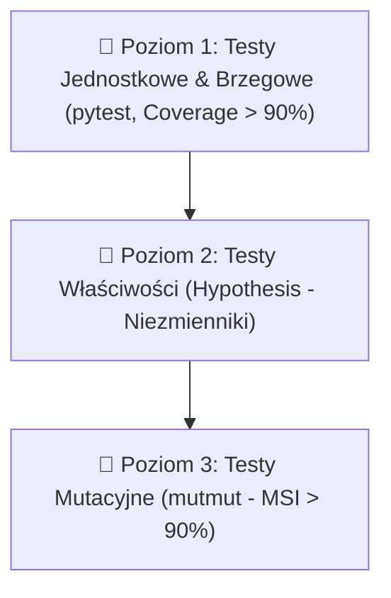

# 🚀 Przewodnik dla Kubusia: Jak używać RAE-Suite do pisania kodu, zaawansowanych testów i badań doktoranckich (z agentem Hermes)

> **Dla kogo:** Kubuś (doktorat, badania naukowe, implementacja algorytmów i modeli)  
> **Maszyna robocza:** Node 1 (Lumina, Arch Linux, i7-14700KF, 64 GB RAM, NVIDIA RTX 4080 16 GB VRAM)  
> **Kluczowi asystenci i narzędzia:** Agent **Hermes**, silnik pamięci **RAE-Suite**, **SonarQube** (Rating A), **mutmut** (testy mutacyjne), **Hypothesis** (property-based testing), **RAE-CRL** (pętla badawcza).

---

## 1. 🎯 Wprowadzenie: Inżynieria kodu naukowego na poziomie Google / DeepMind

W tradycyjnym środowisku akademickim kod badawczy często ma poważne problemy:
- Działa tylko raz (brak powtarzalności środowiska).
- Brakuje w nim testów, więc zmiana jednego parametru psuje algorytm w nieoczekiwanym miejscu (regresja).
- Po 6 miesiącach nikt (nawet sam autor) nie pamięta, dlaczego w linijce 142 wpisano stałą `0.042`.
- Recenzenci prac naukowych coraz częściej wymagają zweryfikowanego, powtarzalnego kodu źródłowego (Artifact Evaluation).

Dzięki **RAE-Suite** i agentowi **Hermes** masz na swoim komputerze (Node 1) profesjonalną infrastrukturę jakościową. Hermes nie pisze kodu „na oko” — pisze go w oparciu o:
1. **Piramidę testów**: od prostych testów jednostkowych, przez testowanie właściwości matematycznych (`hypothesis`), aż po **testy mutacyjne (`mutmut`)**, które sprawdzają, czy testy naprawdę potrafią wykryć błąd.
2. **SonarQube Rating A**: zero tolerancji dla błędów (Bugs: 0, Vulnerabilities: 0, Code Smells: 0, Coverage >90%).
3. **Pamięć semantyczną RAE**: Hermes pamięta wszystkie wcześniejsze eksperymenty, biblioteki i decyzje architektoniczne.
4. **Epistemiczny rejestr RAE-CRL**: powiązanie każdego commita w Git z konkretną hipotezą badawczą.

---

## 2. 🖥️ Twoje środowisko i narzędzia na Node 1

Wszystko działa bezpośrednio na Twoim komputerze pod kontem użytkownika `operator`:

| Narzędzie / Usługa | Gdzie działa / Adres | Do czego służy |
| :--- | :--- | :--- |
| **Ollama (Lokalne LLM)** | `http://localhost:11434` | Lokalne modele LLM napędzane RTX 4080: `hermes3:8b`, `qwen2.5-coder:14b`, `deepseek-r1:8b` |
| **RAE-Suite Memory API** | `http://localhost:8000` | Pamięć długoterminowa dla agenta Hermes (wektory + Qdrant na `:6333`) |
| **SonarQube Server** | `http://localhost:9000` | Centralny serwer analizy jakości kodu i długu technologicznego |
| **RAE-CRL Lab Desk** | `http://localhost:8503` | Pulpit badawczy do śledzenia hipotez, eksperymentów i nieudanych prób |
| **uv** | `~/.local/bin/uv` | Błyskawiczny manager środowisk wirtualnych i pakietów Pythona |
| **pytest & pytest-cov** | W wirtualnym środowisku | Uruchamianie testów i raportowanie procentowego pokrycia kodu |
| **mutmut** | `~/.local/bin/mutmut` | Silnik testów mutacyjnych (sprawdzanie odporności testów) |
| **sonar-scanner** | `~/.local/bin/sonar-scanner` | Narzędzie wysyłające Twój projekt do analizy w SonarQube |

---

## 3. 📁 Wzorcowa struktura projektu naukowego (Project Blueprint)

Gdy zaczynasz nowy moduł lub program do doktoratu (np. w `~/projects/optymalizacja-tensorowa`), zorganizuj go według poniższego schematu:

```text
optymalizacja-tensorowa/
├── src/
│   └── optymalizacja/
│       ├── __init__.py
│       ├── solver.py          # Twój algorytm / model
│       └── contracts.py       # Modele danych wejścia/wyjścia (Pydantic v2)
├── tests/
│   ├── conftest.py            # Wspólne fixtures i mocki
│   ├── test_solver_unit.py    # Standardowe testy jednostkowe
│   └── test_solver_props.py   # Testy właściwości matematycznych (Hypothesis)
├── pyproject.toml             # Konfiguracja narzędzi (pytest, coverage, mutmut)
├── sonar-project.properties   # Konfiguracja SonarQube
└── README.md
```

### Gotowy `pyproject.toml`
Stwórz plik `pyproject.toml` w głównym katalogu projektu:

```toml
[project]
name = "optymalizacja-tensorowa"
version = "0.1.0"
description = "Algorytm optymalizacji tensorowej do badań doktoranckich"
requires-python = ">=3.11"
dependencies = [
    "pydantic>=2.6.0",
    "numpy>=1.26.0",
    "scipy>=1.12.0",
]

[project.optional-dependencies]
dev = [
    "pytest>=8.0.0",
    "pytest-cov>=4.1.0",
    "hypothesis>=6.100.0",
    "mutmut>=3.8.0",
    "ruff>=0.3.0",
    "mypy>=1.9.0",
]

[tool.pytest.ini_options]
minversion = "8.0"
addopts = "-ra -q --cov=src --cov-report=term-missing --cov-report=xml:coverage.xml"
testpaths = ["tests"]

[tool.coverage.run]
branch = true
source = ["src"]

[tool.coverage.report]
fail_under = 90.0
show_missing = true

[tool.mutmut]
paths_to_mutate = "src/"
runner = "pytest -q"
```

### Gotowy `sonar-project.properties`
Stwórz plik `sonar-project.properties`:

```properties
sonar.projectKey=optymalizacja-tensorowa
sonar.projectName=Optymalizacja Tensorowa - Badania PhD
sonar.projectVersion=1.0

sonar.sources=src
sonar.tests=tests

sonar.python.coverage.reportPaths=coverage.xml
sonar.python.version=3.12

sonar.host.url=http://localhost:9000
sonar.token=squ_1111222233334444555566667777888899990000
```

---

## 4. ✍️ Cykl Pisania Kodu z Hermesem (Write & Refactor)

### Zasada 1: Hard Contracts (Twarde Kontrakty Danych)
Nie przekazuj luźnych słowników (`dict`) ani krotek (`tuple`) o nieznanym formacie. Używaj Pydantic v2 lub dataclasses:

```python
# src/optymalizacja/contracts.py
from pydantic import BaseModel, Field, PositiveFloat, PositiveInt

class SolverConfig(BaseModel):
    max_iterations: PositiveInt = Field(default=1000, description="Maksymalna liczba iteracji")
    tolerance: PositiveFloat = Field(default=1e-5, description="Próg zbieżności")
    learning_rate: PositiveFloat = Field(default=0.01, description="Krok uczenia")

class OptimizationResult(BaseModel):
    converged: bool
    final_loss: float
    iterations_run: int
    optimal_params: list[float]
```

### Zasada 2: Zero Drift (Chirurgiczne Zmiany)
Gdy prosisz Hermesa o poprawkę lub rozszerzenie funkcji, Hermes ma modyfikować **wyłącznie** tę funkcję i jej testy. Nie pozwól agentowi na "przepisywanie połowy pliku przy okazji", bo to wprowadza trudne do wykrycia regresje.

---

## 5. 🧪 Pełna Piramida Testów: Jak testować kod naukowy

W badaniach naukowych tradycyjny test `assert add(2, 2) == 4` to za mało. Stosujemy **4-poziomową piramidę**:



---

### Poziom 1: Testy Jednostkowe i Brzegowe (`pytest`)

Testujemy konkretne przypadki obliczeniowe, wartości typowe oraz **wartości skrajne (Edge Cases)**:
- Co jeśli macierz jest pusta?
- Co jeśli podano wartości ujemne lub `NaN`?
- Co jeśli algorytm osiągnie limit iteracji?

```python
# tests/test_solver_unit.py
import pytest
from optymalizacja.contracts import SolverConfig
from optymalizacja.solver import optimize_quadratic

def test_solver_standard_convergence():
    config = SolverConfig(max_iterations=500, tolerance=1e-4)
    res = optimize_quadratic(initial_x=10.0, config=config)
    
    assert res.converged is True
    assert abs(res.optimal_params[0]) < 1e-3
    assert res.iterations_run < 500

@pytest.mark.parametrize("bad_x", [float("nan"), float("inf")])
def test_solver_rejects_invalid_inputs(bad_x):
    config = SolverConfig()
    with pytest.raises(ValueError):
        optimize_quadratic(initial_x=bad_x, config=config)
```

**Uruchomienie:**
```bash
pytest
```

---

### Poziom 2: Testowanie Właściwości Matematycznych (`hypothesis`)

W obliczeniach naukowych nie jesteś w stanie ręcznie przewidzieć wszystkich możliwych liczb zmiennoprzecinkowych. Biblioteka **Hypothesis** generuje setki losowych, złośliwych wektorów i sprawdza, czy Twój algorytm spełnia **niezmienniki matematyczne (Invariants)**:

- *Niezmiennik 1 (Monotoniczność):* Czy w metodzie spadku gradientu strata w kolejnych krokach maleje?
- *Niezmiennik 2 (Zachowanie energii/masy):* Czy suma prawdopodobieństw zawsze sumuje się do 1.0?
- *Niezmiennik 3 (Symetria):* Czy `f(A, B) == f(B, A)` dla operacji symetrycznych?

```python
# tests/test_solver_props.py
from hypothesis import given, strategies as st
from optymalizacja.contracts import SolverConfig
from optymalizacja.solver import optimize_quadratic

@given(st.floats(min_value=-1000.0, max_value=1000.0, allow_nan=False, allow_infinity=False))
def test_convergence_from_any_starting_point(start_x):
    """Niezmiennik: Funkcja kwadratowa musi zbiegać do 0 niezależnie od punktu startu."""
    config = SolverConfig(max_iterations=2000, tolerance=1e-3, learning_rate=0.05)
    res = optimize_quadratic(initial_x=start_x, config=config)
    
    assert res.converged is True
    assert abs(res.optimal_params[0]) <= 0.05
```

---

### Poziom 3: Testy Mutacyjne (`mutmut` — MSI > 90%)

Najczęstsza pułapka w programowaniu: **masz 100% pokrycia kodu testami (Coverage 100%), a kod i tak ma błędy!** Dlaczego? Bo test wywołał funkcję, ale asercja `assert` była zbyt słaba lub sprawdzała złą zmienną.

**Testy mutacyjne (`mutmut`)** to ostateczny sprawdzian prawdy:
1. `mutmut` bierze Twój kod źródłowy i tworzy jego zmutowane wersje ("mutanty"):
   - zamienia `+` na `-`
   - zamienia `<` na `<=`
   - zamienia `True` na `False`
   - usuwa wywołanie funkcji
2. Uruchamia Twój zestaw testów dla każdego mutanta:
   - **Killed (Zabity)**: Twój test wykrył błąd i padł na czerwono -> **SUPER! Test działa!**
   - **Survived (Przeżył)**: Zmieniono kod, a Twoje testy nadal przeszły na zielono -> **ALARM! Twój test jest pozorny!**

#### Jak uruchomić `mutmut` na Node 1:
```bash
# 1. Uruchomienie mutacji dla wskazanego katalogu:
mutmut run --paths-to-mutate src/

# 2. Wyświetlenie wyników i wskaźnika MSI (Mutation Score Indicator):
mutmut results

# 3. Podgląd konkretnego ocalałego mutanta (np. nr 4):
mutmut show 4
```

**Cel naukowy:** Osiągnięcie wskaźnika **MSI > 85-90%** dla kluczowych algorytmów obliczeniowych.

---

## 6. 🏛️ Weryfikacja jakości w SonarQube (Rating A)

Na Node 1 działa lokalna instancja SonarQube (`http://localhost:9000`). Po napisaniu kodu i uruchomieniu testów z wygenerowaniem raportu `coverage.xml`:

```bash
# 1. Wygenerowanie testów i raportu pokrycia:
pytest --cov=src --cov-report=xml:coverage.xml

# 2. Uruchomienie skanera SonarQube:
sonar-scanner
```

Otwórz w przeglądarce: **`http://localhost:9000`** (lub `http://100.68.166.117:9000`).

### 6 Złotych Zasad Jakości RAE-Suite:
1. **Vulnerabilities: 0** (brak luk bezpieczeństwa)
2. **Bugs: 0** (brak logicznych błędów czasu wykonania)
3. **Code Smells: 0** (czysty kod, niska złożoność cyklomatyczna)
4. **Security Hotspots: 100% reviewed**
5. **Coverage: > 90.0%**
6. **Duplications: 0.0%** (brak powielania kodu)

Gdy Sonar wskaże `Code Smell` (np. za wysoka złożoność obliczeniowa funkcji), poproś Hermesa:
> *„Hermes, SonarQube wskazał Code Smell w pliku `solver.py` linia 85 (złożoność cyklomatyczna = 18). Rozbij tę pętlę na mniejsze, jednoznaczne metody pomocnicze z zachowaniem kontraktu i upewnij się, że wszystkie testy przechodzą.”*

---

## 7. 🔄 Powiązanie Kodu z RAE-CRL (Pętla Badawcza)

Gdy kod jest gotowy, przetestowany i spełnia wymogi SonarQube, powiąż go z procesem badawczym w **RAE-CRL**:

```bash
# 1. Zapisz numer commita i stan hipotezy
COMMIT_HASH=$(git rev-parse --short HEAD)

# 2. Zarejestruj formalny eksperyment powiązany z kodem:
rae-crl add experiment "Eksperyment z optymalizacją tensorową (commit: $COMMIT_HASH)" "Parametry: batch=64, lr=0.001, tolerance=1e-5. Testy jednostkowe 100% PASS, mutmut MSI 92%." "doktorat-kubus"

# 3. Jeśli eksperyment numeryczny wykaże anomalię, zarejestruj to natychmiast:
# (Porażka z analizą to w nauce sukces metodologiczny!)
```

Możesz też wejść na pulpit: **`http://localhost:8503`**, aby podejrzeć graf zależności między wersjami kodu a Twoimi wnioskami.

---

## 8. 📋 Ściągawka Gotowych Promptów dla Hermesa (Cheat Sheet)

Skopiuj i wklej poniższe prompty bezpośrednio do agenta Hermes:

### 🔹 Prompt 1: Generowanie testów jednostkowych i brzegowych
> *„Hermes, przeanalizuj moduł `src/optymalizacja/solver.py`. Przygotuj do niego wyczerpujący zestaw testów jednostkowych w `tests/test_solver_unit.py` przy użyciu pytest. Uwzględnij przypadki typowe, wartości brzegowe (dzielenie przez zero, wartości NaN/Inf, puste dane) oraz weryfikację rzucania właściwych wyjątków. Wymagane pokrycie kodu > 90%.”*

### 🔹 Prompt 2: Generowanie testów właściwości (Hypothesis)
> *„Hermes, na podstawie kodu `src/optymalizacja/solver.py` zidentyfikuj niezmienniki matematyczne (np. monotoniczność, zachowanie sumy prawdopodobieństw, symetrię) i napisz testy właściwości w `tests/test_solver_props.py` przy użyciu biblioteki `hypothesis`. Zastosuj odpowiednie strategie generowania danych liczbowych.”*

### 🔹 Prompt 3: Analiza i naprawa testów mutacyjnych
> *„Hermes, uruchomiłem `mutmut run --paths-to-mutate src/` i mutant nr 7 przeżył w funkcji `compute_gradient` (podmiana operatora `<` na `<=`). Przeanalizuj dlaczego istniejące testy nie wychwyciły tej zmiany i dopisz precyzyjną asercję testową, która zabije tego mutanta.”*

### 🔹 Prompt 4: Refaktoryzacja pod wymogi SonarQube Rating A
> *„Hermes, przeanalizuj raport SonarQube dla naszego projektu. Zadbaj o spełnienie Złotych Wytycznych: Bugs: 0, Code Smells: 0, Duplications: 0.0%. Wprowadź chirurgiczne poprawki w kodzie bez zmiany zachowania zewnętrznego API.”*

### 🔹 Prompt 5: Rejestracja wyniku w pamięci RAE i RAE-CRL
> *„Hermes, zakończyliśmy implementację algorytmu. Wszystkie testy przeszły (Coverage 94%, mutmut MSI 91%, SonarQube Rating A). Zarejestruj ten kamień milowy w RAE-CRL jako eksperyment 'Solver-v1-Verification' w projekcie 'doktorat-kubus' i zapisz najważniejsze wnioski w pamięci RAE.”*

---

## Podsumowanie

Połączenie Twojej wiedzy dziedzinowej, mocy obliczeniowej Node 1 (RTX 4080) oraz rygoru inżynieryjnego RAE-Suite daje Ci narzędzie, które:
- Gwarantuje niezawodność wyników do publikacji w prestiżowych czasopismach (IEEE, ACM, Nature/Science family).
- Drastycznie skraca czas pisania kodu i debugowania.
- Zapewnia, że żaden wniosek ani eksperyment nie przepadnie w trakcie 4 lat doktoratu.
